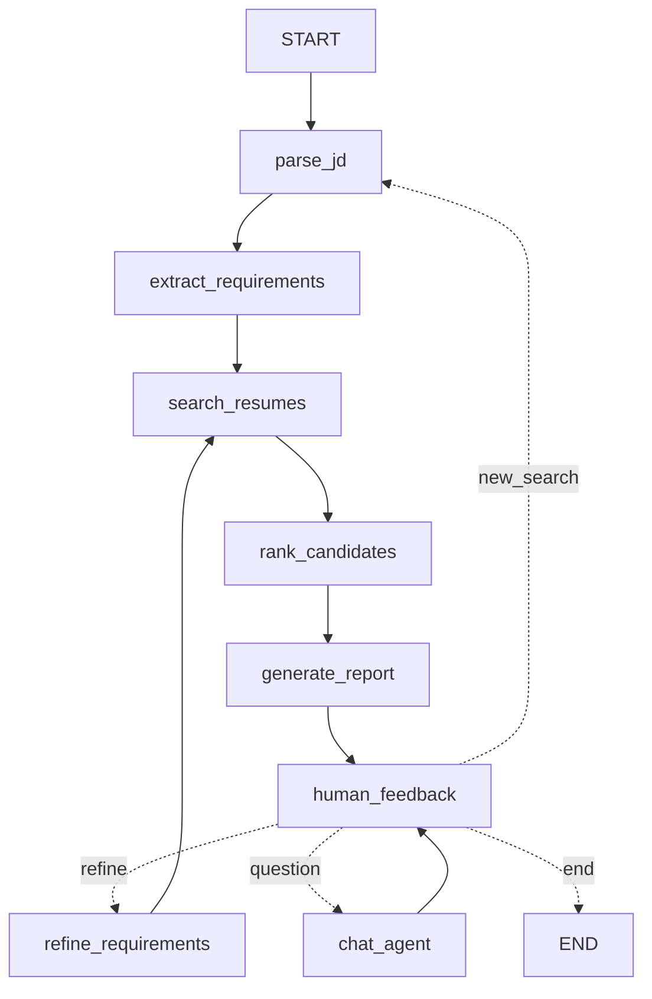

# Resume Matching Agent (Milestone 3)

A conversational **LangGraph** agent that screens 100 resumes against a job description in three rounds, explains every ranking, and lets a recruiter refine requirements mid-conversation. It builds on:

- **Milestone 1:** file-system tools (`fs_tools.py`: read PDF/DOCX/TXT, list, write, search)
- **Milestone 2:** resume RAG (`resume_rag.py`, MiniLM + ChromaDB) and the hybrid matcher (`job_matcher.py`)

Real output from `python chat_cli.py --offline --script flows/05_refine_rerank.txt`, trimmed:

```
you › jobs/jd_platform_engineer.txt
  · [parse_jd] JD source: jobs/jd_platform_engineer.txt (31 words)
  · [extract_requirements] [heuristic] must-have=['Go', 'Kubernetes'] nice-to-have=['AWS', 'Prometheus', 'Terraform'] min_years=5
  · [search_resumes] Round 1: scored 100 resumes -> top 10 (6 meet every must-have + years)
  · [rank_candidates] Round 2: deep analysis of 10 candidates
  · [rank_candidates] Round 3: verdicts {'hire': 6, 'maybe': 4, 'no-hire': 0}
  · [generate_report] Match report written to reports/senior_platform_engineer_v1_....md
you › Drop Go and make Terraform a must-have
  · [human_feedback] intent=refine
  · [refine_requirements] v2: Terraform moved nice-to-have → must-have; Go removed from must-have
  · [search_resumes] Round 1: scored 100 resumes -> top 10 (7 meet every must-have + years)
  ...
  Ranking changes:
  • Diego Larsson ↑6: has newly required Terraform; no longer penalised for missing Go
  • Aisha Khan ↓2: loses credit for Go
```

## Architecture

### State machine




The diagram is generated from the compiled graph by `python diagram.py`, which writes `docs/state_machine.mmd` and `.png`.

| Node | What it does |
|---|---|
| `parse_jd` | Loads a JD file (e.g. `jobs/jd_ml_engineer.txt`) via the M1 `read_file`, or treats a natural-language request as the JD. |
| `extract_requirements` | LLM structured output: must-have vs nice-to-have skills and minimum years. Skills are mapped onto the indexed vocabulary. |
| `search_resumes` | **Round 1:** hybrid semantic + keyword score over **all 100** resumes (M2 RAG). Keeps the top 10, qualified candidates first. |
| `rank_candidates` | **Round 2:** one deep LLM analysis per candidate (fit score, strengths, gaps, evidence, improvement suggestions). **Round 3:** one panel-style LLM call issuing hire / maybe / no-hire. When requirements were refined, it also computes rank movements with reasons. |
| `generate_report` | Writes a markdown match report to `reports/` using the M1 `write_file`. Also posts a chat summary. |
| `human_feedback` | `interrupt()` pauses the graph for the user. The next message is classified as `refine` / `new_search` / `question` / `end`: rules handle clear cases and the LLM handles the rest. |
| `refine_requirements` | Applies "drop Go, make Terraform a must-have"-style edits and versions the requirements. The old ranking is kept so the new report can explain each move. |
| `chat_agent` | A tool-calling loop for questions (compare, why, interview questions, read/save files). |

### Agent state

`AgentState` (a `TypedDict`) is checkpointed per conversation thread by `MemorySaver`.

- **Conversation:** `messages` (with the `add_messages` reducer), `query`.
- **Job understanding:** `jd_text`, `requirements`, `requirements_history` (every version), `requirement_changes`.
- **Screening:** `round1` (top 10 with score components), `round2` (deep analyses), `round3` (verdicts).
- **Shortlist and reasoning:** `shortlist` (merged ranked view, including each candidate's reasoning), `previous_shortlist`, `rank_changes`.
- **Output:** `report_md`, `report_path`, and `trace`, an append-only reasoning log shown in both UIs.

### Tools (`agent_tools.py`)

| Tool | Source |
|---|---|
| `read_file`, `list_files`, `write_file`, `search_in_file` | Milestone 1 file tools |
| `rag_search(query, top_k, must_have, min_years)` | Milestone 2 RAG search, scoring all 100 resumes |
| `extract_requirements(jd)` | New. Must-have vs nice-to-have parsing. |
| `compare_candidates(candidate_ids)` | New. Head-to-head table of requirement coverage, scores and verdicts. |
| `generate_interview_questions(candidate_id)` | New. Verifies the candidate's strengths and probes their gaps. |
| `explain_ranking(a, b)`, `get_candidate_analysis`, `get_shortlist`, `get_rank_changes` | Explainability helpers |

Candidates can be referred to by name ("John Doe"), first name ("John"), id (`John_Doe`) or rank ("#2"). An ambiguous first name resolves to the best-ranked shortlisted match. If there is none in the shortlist, it resolves to the best-scoring match in the pool, and the agent says so.

### Scoring

```
round1 = 0.6 * semantic (MiniLM cosine, best chunk) + 0.4 * keyword (requirement-skill coverage)
final  = 0.4 * round1 + 0.6 * round2 fit (LLM deep analysis)
rank   = by (meets all must-haves + years, final)
```

Candidates with a fit score of 50–70 count as borderline and get improvement suggestions in the report.

### Robustness: offline mode

Every LLM step has a deterministic heuristic fallback:
- regex and vocabulary-based requirement parsing
- coverage-based fit scoring
- threshold verdicts
- rule-based tool dispatch for chat

The fallback is used automatically on API errors, such as an exhausted quota. It can also be forced with `MATCHING_AGENT_OFFLINE=1` or `--offline`. The test suite runs offline, so it is fast, free and deterministic.

## Setup

```bash
python3.12 -m venv .venv && source .venv/bin/activate
pip install -r requirements.txt
python generate_dataset.py      # 100 resumes (60 txt / 20 docx / 20 pdf) + 8 JDs (already committed)
python resume_rag.py build      # index -> ./chroma_db (first run downloads MiniLM, ~90 MB)
echo "OPENROUTER_API_KEY=sk-or-..." > .env
```

Optional environment variables:

| Variable | Default | Purpose |
|---|---|---|
| `OPENROUTER_MODEL` | `anthropic/claude-sonnet-4.5` | Model used for every LLM step |
| `OPENROUTER_MAX_TOKENS` | `2048` | Output cap for chat replies (structured calls use at most 1024) |
| `MATCHING_AGENT_OFFLINE` | unset | Set to `1` to skip the LLM and use the heuristics |

## Usage

```bash
python chat_cli.py                                    # interactive terminal chat
python chat_cli.py --script flows/05_refine_rerank.txt
streamlit run app.py                                  # web chat
./demo.sh                                             # paced walkthrough for recording
```

The Streamlit app shows the chat with a live reasoning trace for each turn. Its sidebar shows the current requirements version, the shortlist with verdicts, the full report and the state diagram.

## Test scenarios

The conversation flows live in `flows/`. Each one runs as a script and as a pytest case.

| Flow | Covers |
|---|---|
| `01_jd_full_report` | JD file → 3 rounds → report → borderline candidates and improvement suggestions |
| `02_natural_language_search` | "Find me candidates with React and 3+ years experience" → strengths and gaps of #1 |
| `03_compare_top3` | "Compare the top 3 matches side by side" |
| `04_why_ranking` | "Why did #1 rank higher than #3?", then "Why did John rank higher than Jane?" (Jane is outside the shortlist) |
| `05_refine_rerank` | Drop Go, make Terraform a must-have, require 8+ years → two re-ranks with explained movements |
| `06_interview_questions` | Interview questions for #1 → saved with `write_file` |
| `07_new_search_midstream` | Switching roles mid-conversation, then comparing on the new shortlist |

```bash
pytest -q                 # 26 offline tests: tools, routing, 3 rounds, refinement, explanations, all flows
LIVE=1 pytest -q -m live  # live LLM smoke test
```

## Files

```
matching_agent.py   LangGraph state, nodes, routing, report rendering, MatchingSession
agent_tools.py      tools + round 1/2/3 logic + LLM schemas + heuristic fallbacks
llm.py              OpenRouter ChatOpenAI factory, structured-output helpers, offline switch
chat_cli.py         terminal UI (rich), scripted flows
app.py              Streamlit UI
diagram.py          exports docs/state_machine.{mmd,png}
fs_tools.py         Milestone 1 file tools
resume_rag.py       Milestone 2 indexing (paths now module-relative)
job_matcher.py      Milestone 2 matcher (+ `skills` and `pool` params, score components)
generate_dataset.py synthetic dataset (100 resumes, 8 JDs)
flows/              7 conversation scripts
tests/              pytest suite
```
